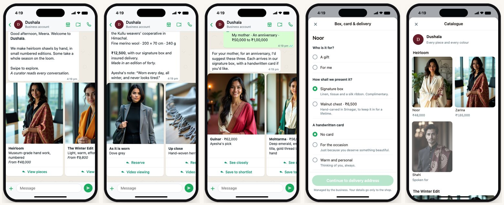
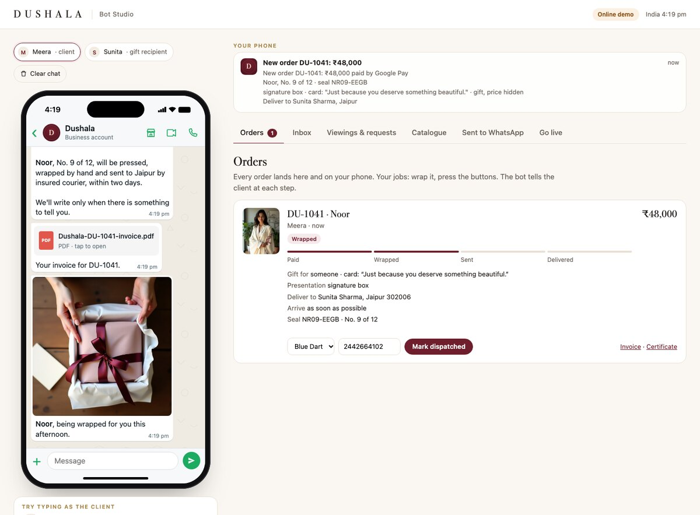

# Dushala · a premium shawl shop inside WhatsApp

A complete WhatsApp concierge for a heirloom-shawl house. Customers browse a photo lookbook, get help choosing a gift,
reserve a piece, choose a gift box and a handwritten card, share an address and pay by UPI, all without leaving the chat.
The shop gets each order on its phone and taps three buttons: **Wrapped**, **Dispatched**, **Delivered**.

### ▶ [Try the live demo](https://01adityarathore-art.github.io/dushala-whatsapp-shop/)

The demo runs entirely in your browser. On the left is what a customer sees on WhatsApp; on the right is the shop's back office.
Nothing is sent anywhere and no payment is real.



## What the customer experiences

- **A lookbook, not a menu.** The first message is a swipe of photo cards: four collections, a gift finder and a concierge.
- **One card per design.** *See closely* swipes through the piece worn, up close, laid flat, and every colour it comes in.
- **Gift finder.** Three taps (who, occasion, budget) and three different designs, with the curator's pick first.
- **A shortlist** for pieces they want to think about. It greets them when they come back.
- **One page for the details**: gift or self, signature box or walnut chest, a handwritten card (ready wording offered), and the arrival day.
- **WhatsApp's own address form and in-chat UPI payment** (Razorpay), then an invoice.
- **Every step after**: a photo of the piece being wrapped, tracking, delivery, a certificate of authenticity.
- **A person when they want one.** Curator chat, a video viewing in daylight, wedding gifting, monograms, delivery abroad.
- **The recipient becomes a client.** A QR in the box registers the piece and offers yearly care.
- Understands everyday English and Hinglish: *"something red for my mom under 70k"*, *"kitne ka hai"*, *"is it real pashmina?"*

## What the shop does



The **Studio** shows each order with its gift details, card text and address, and the next button to press. It also has
the curator inbox, booked video viewings, requests (wedding gifting, bespoke, abroad), what clients have shortlisted,
the catalogue with stock, and every message exactly as WhatsApp receives it.

## Why it works (the behaviour design)

| How people behave | What the bot does |
|---|---|
| We judge a shawl by eye in a second; reading a list is work | Pictures first, swiped like a lookbook |
| Too many choices and people choose nothing | One card per design; colours appear only on *See closely*. The gift finder gives three, not thirty |
| A big yes is easier after a small one | See closely → Save → Reserve. Nobody is asked to buy on the first picture |
| Gift buyers compare and fear choosing wrong | A shortlist; the curator's pick first; a quiet exchange for the recipient, price never shown |
| Every extra question loses people | Box, card and arrival day on one page. Address and payment use WhatsApp's own forms |
| A blank card freezes people | Three ready card messages, written for the person and the occasion |
| People leave and forget an unfinished task | The welcome says where they left off, with a *Continue* card |
| Losing something you've set aside stings | One honest reminder ten minutes before the hold ends, with *Release it*. Never a second one |
| The first price you see sets the frame | Each collection opens on its finest piece |
| Premium buyers distrust pressure | No discounts, no fake countdowns, no exclamation marks. Scarcity only when real (numbered editions) |
| The end of an experience is what's remembered | A wrapping photo, a certificate, and for gifts an offer to remind them next year |

## What's real, and what's sample

- **Real and working:** the whole conversation, the gift finder, holds and stock, orders, payments flow, invoices,
  certificates, the Studio, and the code that talks to WhatsApp's official Cloud API.
- **Sample:** the brand name *Dushala*, the 15 pieces, prices and seller details. The model photos are AI-generated
  stand-ins; the real shop uses photographs of its own shawls.
- **Not yet connected:** a real WhatsApp number. That needs the shop's verified Meta Business account, a phone number and
  Razorpay (steps below).

## Run it on your computer

Needs [Node.js](https://nodejs.org) 20 or newer. No other installs.

```bash
npm start
```

Then open http://127.0.0.1:8985. Run every customer journey as a test with `npm test` (30 tests; each message is also
checked against WhatsApp's limits).

## Go live on WhatsApp

1. **A number for the shop**, ideally a fresh SIM.
2. **A verified Meta Business account** (business.facebook.com).
3. **A WhatsApp app** on Meta for Developers with that number: phone number ID, access token, app secret.
4. **Keys in `.env`** (never commit it): `WA_TOKEN`, `WA_PHONE_ID`, `WA_APP_SECRET`, `WA_VERIFY_TOKEN`.
5. **Razorpay**, linked in WhatsApp Manager → Payments; its name goes in `RAZORPAY_CONFIG_NAME`.
6. **The two one-page forms**: upload `flows/order_options.json` and `flows/gift_finder.json` in WhatsApp Manager → Flows,
   then set `FLOW_ORDER_OPTIONS_ID` and `FLOW_GIFT_FINDER_ID`. Until then the bot asks the same questions one at a time.
7. **The catalogue behind the shop icon**: a Commerce Manager data feed from `PUBLIC_URL/catalogue-feed.csv`.
8. **Online around the clock** (a small server, or a Cloudflare tunnel): `PUBLIC_URL`, webhook at `PUBLIC_URL/webhook`,
   and a `STUDIO_KEY` so only the shop can open the Studio.
9. **Seven message templates** approved (listed in the Studio's *Go live* tab), for updates after 24 hours of silence.
10. **Real pieces, photos and details**: `catalogue.csv`, `photos/<piece>/hero.jpg` (+ `detail.jpg`, `flat.jpg`), and
    the seller, GST and bank details in `config.json`. Confirm GST treatment with a CA.

Optional: `TELEGRAM_BOT_TOKEN` and `TELEGRAM_CHAT_ID` send order alerts to Telegram too.

## Change things

- **Pieces and prices:** `catalogue.csv` (opens in Excel or Numbers). Rows sharing a `design` are colour versions of one
  shawl. A piece is hidden automatically if something is missing, or if it says Pashmina, Kani or Sozni without a GI certificate.
- **Words:** every sentence a customer reads is in `src/copy.js`.
- **Shop details, curator name, hours, prices of extras:** `config.json`.

## For developers

Plain Node.js, no dependencies. `src/engine.js` is the brain: it takes one customer action and returns messages,
WhatsApp-neutral. `src/whatsapp.js` turns those into Cloud API payloads (buttons, lists, media carousels, Flows,
`catalog_message`, `cta_url`, India `address_message`, `order_details` with Razorpay) and reads webhooks.
`src/app-core.js` paces delivery and serves the Studio; it runs both in `server.js` and, for the online demo, in the
browser (`public/demo-backend.js`, built by `npm run build:demo` and published to GitHub Pages on every push).
